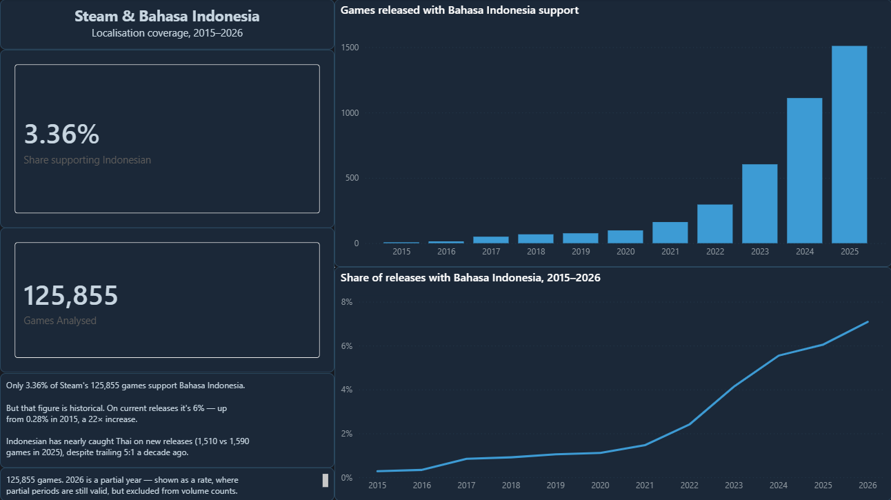

# Steam & Bahasa Indonesia

**Only 3.36% of Steam's 125,855 games support Bahasa Indonesia.**

But that number is dragged down by older games. Looking at recent releases
only, it's about 6% — up from 0.28% in 2015.

> **Stack:** MySQL 8.0 · Power BI · DAX
> **Data:** [Steam Games Dataset](https://www.kaggle.com/datasets/fronkongames/steam-games-dataset) — 125,855 games



---

## The question

Indonesia has a lot of gamers. Steam has about 126,000 games. I wanted to know
how many of them Indonesians can actually play in their own language, and
whether that's getting better.

Most Steam analyses I found were about price or genre. I couldn't find one that
asked this.

## What I did

**1. Checked the file before loading it.**

This turned out to matter. The CSV has a broken header — 39 column names but 40
columns of data, because a comma is missing between `Discount` and `DLC count`.
Everything after `Price` is shifted one column across.

I found it because English came out at 2.15%. Almost every Steam game is in
English, so that number was obviously wrong, which told me the columns weren't
lining up.

**2. Loaded it in two steps.**

| Table | What it holds |
|---|---|
| `stg_games` | everything as text, so nothing can fail the import |
| `games` | proper types — `INT`, `DECIMAL(10,2)`, `SMALLINT`, `TINYINT` |

I picked the types by measuring first, not guessing. `supported_languages` goes
up to 1,216 characters, so if I'd used the usual `VARCHAR(255)` it would have
cut off the column the whole project depends on.

**3. Wrote four queries** — overall share, share by year, comparison with Thai
and Vietnamese, and share by price band. They're in `sql/03_analysis.sql` with
the answers written above each one.

## What I found

**1. The overall number hides the trend.**

3.36% across all games. But by release year: 0.28% in 2015, 6.05% in 2025.
Most of the catalogue is old games that were never localised.

**2. Indonesian has almost caught up with Thai.**

| | Indonesian | Thai |
|---|---|---|
| 2015 | 7 | 38 |
| 2025 | 1,510 | 1,590 |

Overall Indonesian looks behind Thai (3.36% vs 4.99%), but that's history. On
new releases they're about level now.

One thing worth saying: Indonesia has roughly four times Thailand's population.
So the same number of games means a lot less coverage per person.

**3. Expensive games get localised more.**

14.77% of games over $30 support Indonesian, compared to 1.88% of free games.
Localisation costs money, so bigger budgets do more of it.

But it isn't a straight line — games under $10 (3.89%) do better than games at
$10–30 (1.67%). I don't know why. Might be cheaper Asian-published games that
localise as standard. I've left it as an open question rather than guessing.

## What this doesn't tell you

- **Steam is PC only.** Most Indonesian gaming is on mobile, so this says
  nothing about Indonesian gaming overall.
- **2026 is only half a year.** I show it in the percentage chart, because a
  percentage still works on half a year. I left it out of the count chart,
  because 235 games next to 1,510 would look like a crash when it's just fewer
  months.
- **"Supports Indonesian" just means it's listed on the store page.** It might
  be full localisation or only subtitles — the data doesn't say.
- **Prices are in US dollars.** Steam charges different prices in Indonesia, so
  converting to rupiah would give a number that looks right but isn't what
  anyone actually pays. I left it in USD.

## Files

```
sql/03_analysis.sql   the four queries, with answers
powerbi/              dashboard.pbix and the theme
docs/dashboard.png    screenshot
PROFILING-CHECKLIST.md  the checks I run on any new file before loading it
```

Raw CSVs aren't included — `games.csv` is 382 MB and it's a public Kaggle
download.

## Licence

Data from the [Steam Games Dataset](https://www.kaggle.com/datasets/fronkongames/steam-games-dataset).
Not affiliated with Valve or Steam.

---

*Built with AI assistance (Claude). The question and the conclusions are mine.*
